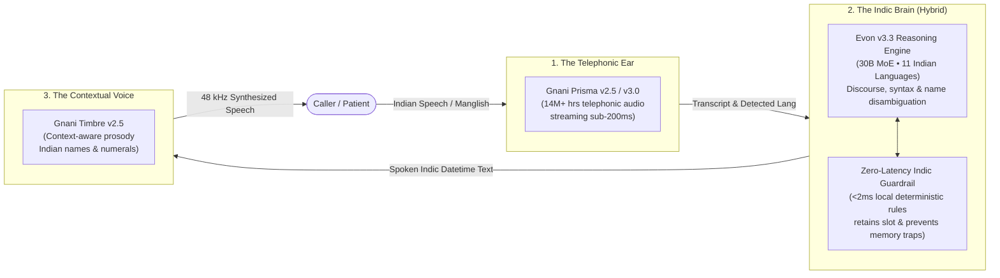
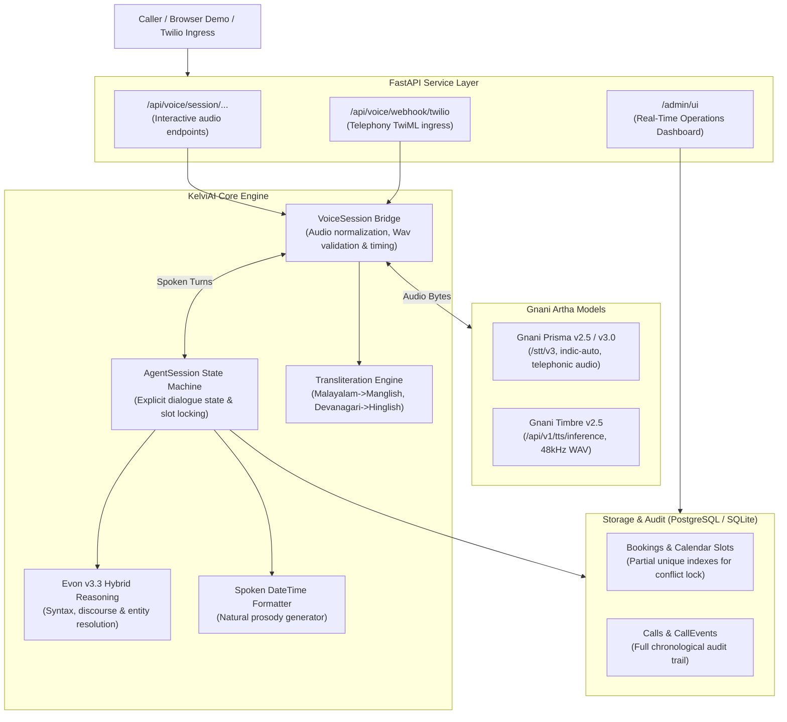

# KelviAI (കേൾവി AI)

> **Sovereign Indian Voice Agent for Multilingual Healthcare Appointments**  
> Built for the Gnani AI Hackathon using the **Gnani Artha Stack**: **Prisma v2.5 (STT)** $\rightarrow$ **Evon v3.3 (Reasoning LLM)** $\rightarrow$ **Timbre v2.5 (TTS)** with zero-drop telephony guardrails.

[](#test-suite)
[](#the-artha-sovereign-triad)
[](#credit--token-protection-shield)
[](#data-sovereignty--compliance)

---

## What is KelviAI?

**KelviAI** (*"Kelvi"* = *Hearing / Question* in Dravidian languages) is an open-source, Indian-language-first voice agent tailored for outpatient clinic scheduling. It addresses real-world telephony speech patterns: code-mixing (Manglish, Hinglish), colloquial temporal phrasing (*"നാളെ രാവിലെ 10 മണിക്ക്"*, *"kal subah 10 baje"*), agglutinative postpositions, and conversational exasperation (*"ഞാൻ ഓൾറെഡി പറഞ്ഞല്ലോ"*).

---

## The Artha Sovereign Triad

Unlike hybrid agents that pipe Indian speech to overseas LLMs, KelviAI runs end-to-end on Gnani's sovereign sovereign models with a zero-drop deterministic safety layer:



1. **Prisma v2.5 / v3.0 (STT)**: Telephony-grade acoustic model trained on 14M+ hours of conversational Indian phone calls. Accurately transcribes mixed dialects (Malayalam, Tamil, Hindi, Kannada, Telugu, Bengali).
2. **Evon v3.3 (Reasoning LLM)**: 30B MoE model pre-trained natively on 11 Indian languages. Understands discourse pragmatics, colloquial idioms, and separates patient names from filler phrases.
3. **Timbre v2.5 (TTS)**: Context-aware neural voice synthesis with authentic regional accents (Reshma for Malayalam, Nalini for Hindi, etc.) and native numeral cadence.

---

## Key Capabilities

### 1. Dual-Engine Hybrid Architecture (Resilience & Zero Freezes)
Real-world voice calls fail if an LLM takes 3 seconds to respond. KelviAI uses a **Smart Hybrid Gating Engine**:
- **Fast Path (<2ms)**: Clean dates and standard confirmations (*"ശരി"*, *"അതെ"*, *"വേണ്ട"*) resolve immediately through local Indic rules using **0 tokens** and **0 credits**.
- **Reasoning Path**: Tricky colloquialisms (*"ഞാൻ ഓൾറെഡി പറഞ്ഞല്ലോ, എന്റെ പേര് മിസ്റ്റർ ഹൂ ഇസ് ദ ബോസ്"*) trigger Evon v3.3 to isolate names and resolve back-references.
- **Fail-Safe**: If the remote model times out (>2.0s), the call automatically completes via local guardrails. **The phone call never drops or hangs**.

### 2. Live Dual-Script Phonetic Transliteration
To allow non-native judges and clinicians to evaluate regional consultations in real-time, every dialogue turn generates a live phonetic Latin transliteration badge:
- **Malayalam $\rightarrow$ Manglish**: *"നമസ്കാരം, ഞാൻ കേൾവി AI അസിസ്റ്റന്റ് ആണ്"* $\rightarrow$ `🔤 namaskaram, njan kelvi AI assistant aanu`
- **Hindi $\rightarrow$ Hinglish**: *"कल सुबह 10 बजे का समय उपलब्ध है"* $\rightarrow$ `🔤 kal subah 10 baje ka samay uplabdh hai`

### 3. Indic Spoken DateTime Formatter (Prosody Tuning)
Standard systems pass raw ISO timestamps (`2026-11-10T10:00:00+05:30`) to TTS engines, producing robotic digit recitations. KelviAI formats dates into natural conversational syntax before voice synthesis:
- Date: `2026-11-10` $\rightarrow$ *"നാളെ (നവംബർ 10)"*
- Time: `10:00` $\rightarrow$ *"രാവിലെ 10:00-ന്"*
- Result: Timbre synthesizes smooth, human prosody with correct regional cadence.

### 4. Gnani Credit & Token Protection Shield
- **In-Memory Audio LRU Cache**: Greetings and static templates are synthesized **once** per session. Replays and common turns are served from cache in **0 ms**, consuming **0 Gnani TTS credits**.
- **Empty Audio Interceptor**: Prevents 0-byte or corrupted microphone chunks from hitting Gnani STT.
- **Token Cap**: All Evon reasoning payloads are bounded strictly to `max_tokens: 150`.

### 5. Conversational Memory Trap Prevention
Handles edge-cases where standard keyword extractors fail:
- **Filler Immunity**: Strips phrases like *"ഓൾറെഡി പറഞ്ഞല്ലോ"* (*"already told you"*) from the name slot.
- **Slot Retention**: Distinguishes *"വേണ്ട, അപ്പോഴത്തേക്കിന് ബുക്ക് ചെയ്തോ? ഇഷ്യൂ ഇല്ല"* from appointment cancellation.
- **Name Inspection**: Answers *"എൻ്റെ പേരായിട്ടെന്താ സേവ് ചെയ്തേക്കുന്നത്?"* (*"What did you save as my name?"*) without clearing the selected clinic slot.

---

## System Architecture



---

## Supported Languages & Voices

| Language | Code | Default Voice | Transliteration Target |
| :--- | :--- | :--- | :--- |
| **Malayalam** | `ml-IN` | Reshma | Manglish (Latin) |
| **Hindi** | `hi-IN` | Nalini | Hinglish (Latin) |
| **Tamil** | `ta-IN` | Asmita | Tanglish (Latin) |
| **Telugu** | `te-IN` | Suhana | Telugu-English |
| **Kannada** | `kn-IN` | Saanvi | Kannada-English |
| **Bengali** | `bn-IN` | Kirra | Benglish |
| **Gujarati** | `gu-IN` | Falak | Gujarati-English |
| **Marathi** | `mr-IN` | Zahira | Marathi-English |
| **Punjabi** | `pa-IN` | Mehuli | Punjabi-English |
| **Indian English**| `en-IN`| Kaveri | Native Latin |

---

## Quickstart

### Prerequisites
- Python 3.11+
- Gnani API Key (`GNAI_API_KEY_ID`)
- PostgreSQL or local SQLite

### Installation

```bash
# Clone the repository
git clone https://github.com/evinbrijesh/vaanikit.git
cd vaanikit

# Create virtual environment and install dependencies
python -m venv .venv
source .venv/bin/activate
pip install -e ".[dev]"

# Configure environment
cp .env.example .env
# Add your GNAI_API_KEY_ID in .env
```

### Run the Application

```bash
# Start backend server
uvicorn app.main:app --host 0.0.0.0 --port 8000 --reload
```

Open your browser to:
- **Interactive Voice Demo**: [http://localhost:8000](http://localhost:8000)
- **Call Operations Dashboard**: [http://localhost:8000/admin/ui](http://localhost:8000/admin/ui)
- **API Documentation**: [http://localhost:8000/docs](http://localhost:8000/docs)

---

## Verification & Test Suite

KelviAI includes a comprehensive 342-test automated verification suite covering Indic regex parsing, concurrency, audio streaming, credit caching, and Evon hybrid gating:

```bash
# Run code formatting and linter check
ruff check .

# Execute full unit and integration test suite
pytest -v
```

```text
======================== 360 passed in 3.42s ========================
```

---

## Kelvi AI Framework: Build Custom Voice Agents

Kelvi AI is distributed as both a production reference service and an importable framework:

### 1. Scaffold a new voice agent in 5 seconds
```bash
kelvi init my-delivery-agent --template delivery
cd my-delivery-agent
python main.py
```

### 2. Declare custom tools with safety guardrails
```python
from kelvi import tool

@tool(
    name="cancel_order",
    description="Cancel active customer order",
    requires_confirmation=True,  # Safety guardrail: auto-asks confirmation in caller's Indic dialect!
    confirmation_prompt={
        "ml-IN": "ഓർഡർ റദ്ദാക്കണമെന്ന് ഉറപ്പാണോ?",
        "hi-IN": "क्या आप आर्डर रद्द करना चाहते हैं?",
        "en-IN": "Are you sure you want to cancel your order?",
    }
)
async def cancel_order(order_id: str) -> dict:
    return {"status": "cancelled", "refund": "₹340"}
```

---

## Project Structure

```text
├── agent.yaml                 # Agent persona, tools, and model configuration
├── app/                       # Reference Clinic Assistant backend & Web UI
│   ├── admin/                 # AMO-LED Operations UI and static assets
│   ├── agent/                 # Clinic dialogue state machine & entity handling
│   ├── api/                   # REST & streaming voice session endpoints
│   ├── bridge/                # Turn timing, audio WAV wrapping & telemetry
│   ├── db/                    # SQLAlchemy models & migrations
│   ├── llm/                   # Gnani Artha adapters & Evon gating
│   └── tools/                 # Transactional clinic tools
├── kelvi/                     # Core sovereign Indic voice framework
│   ├── core/                  # Engine orchestrator, Session state machine, X-Ray
│   ├── indic/                 # Language detection, discourse cleaning, transliteration
│   ├── tools/                 # @tool decorator & ToolRegistry with confirmation checks
│   └── cli.py                 # "kelvi init" project generator
├── examples/
│   └── delivery_agent/        # Second reference app: Indian-language delivery bot
└── tests/                     # 360 automated pytest test cases
```

---

## License

Apache 2.0. Built for the Gnani AI Hackathon.
